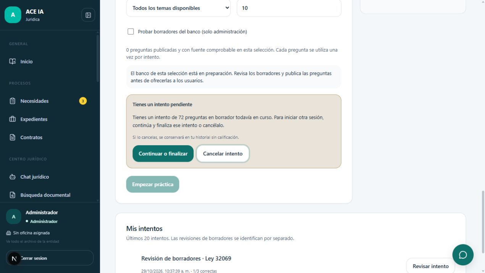
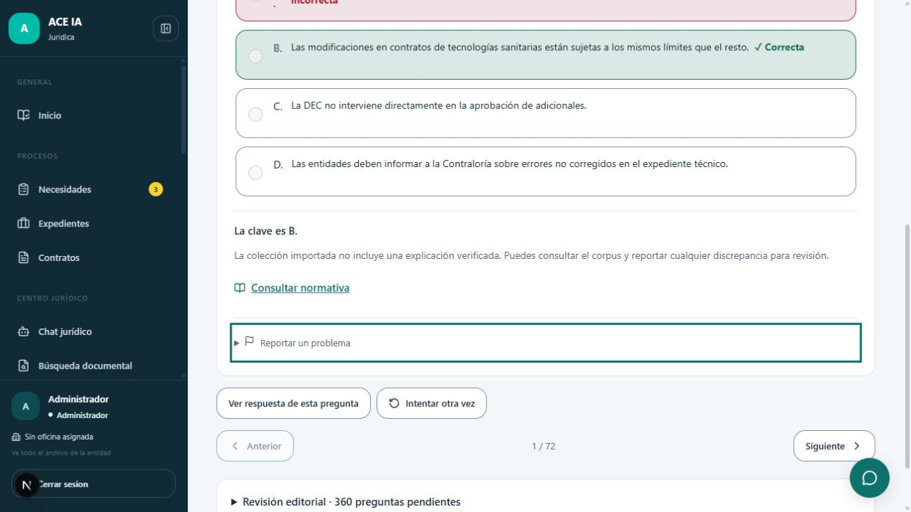

# Auditoría funcional del simulador de ACE

Fecha: 16/11/2026. URL evaluada: `http://localhost:3000/simulador`.

El guardado, la corrección y la rendición funcionan en los flujos comprobados. El refuerzo de errores todavía no es uniforme: el Banco revisado tiene fuentes y repasos, mientras que la práctica de las colecciones importadas no conserva su avance y carece de explicaciones verificadas. Además, un enlace del informe histórico puede dejar la práctica con cero preguntas por un cambio de clasificación.

## Entornos y material

| Elemento | Estado comprobado |
|---|---|
| Código de localhost | `171e407`, rama `codex/aviso-intento-activo`; versión anterior a la publicada |
| Código publicado comparado | `6e815d7`, integrado en `main` |
| Banco revisado | 381 preguntas preparadas y elegibles |
| Biblioteca del Banco | Cinco conjuntos de 72 preguntas, ya publicados |
| Colecciones importadas | Otras cinco colecciones de 72 preguntas; 360 preguntas en total |
| Revisiones de las importadas en base de datos | 0 |
| Importadas sin explicación / sin fuentes | 360 / 360 |
| Importadas sin competencia clasificada | 144 |

Las 360 preguntas importadas pendientes no deben confundirse con las 360 asignaciones de la biblioteca revisada: esta última se ensambla desde el Banco de 381. El acceso a la misma base de datos no significa que localhost esté ejecutando el código reciente de producción.

## Hallazgos prioritarios

### 1. Refuerzo de resultados antiguos puede abrir una selección vacía

**Impacto alto.** Se abrió un resultado histórico y se pulsó «Practicar este tema». El formulario mostró cero preguntas y «El banco de esta selección está en preparación», aunque las preguntas del intento siguen publicadas y elegibles.

La comparación con los registros actuales confirmó estos cambios de etiqueta:

| Etiqueta guardada en el intento | Etiqueta actual |
|---|---|
| Conceptos de contratación | Contenido y vigencia del contrato |
| Modalidades y procedimientos | Procedimientos y modalidades |

El informe pasa el texto del tema histórico a `studyTopic`; el filtro exige coincidencia con la etiqueta actual. El selector puede aparentar «Todos los temas disponibles» porque el valor antiguo ya no existe entre sus opciones, mientras el filtro interno sigue usando ese valor y devuelve cero.

**Recomendación:** resolver el refuerzo por identificador de pregunta, revisión y clasificación actual; validar que el tema exista en el catálogo antes de configurarlo. Si cambió o dejó de estar disponible, explicar el cambio y ofrecer una selección válida. No basta ajustar el número de preguntas.

Reproducido en localhost. La revisión del código reciente confirma que el informe y `studyTopic` todavía usan el texto del tema para este recorrido; no se hizo una segunda reproducción visual en producción.

Referencias: [acción del informe](https://github.com/rroque100/ace/blob/6e815d73e0ceff8a92396e5e4dac61f9cabf7ab1/app/components/exam-learning.tsx#L251), [configuración del tema local](https://github.com/rroque100/ace/blob/6e815d73e0ceff8a92396e5e4dac61f9cabf7ab1/app/components/exam-workspace.tsx#L447), [versión reciente](https://github.com/rroque100/ace/blob/6e815d73e0ceff8a92396e5e4dac61f9cabf7ab1/app/components/exam-workspace.tsx#L447).

### 2. El refuerzo documental de las colecciones importadas está pendiente

**Impacto alto para el aprendizaje.** Al responder incorrectamente se muestra la clave de origen y el mensaje «La colección importada no incluye una explicación verificada». El enlace lleva a Normativa en general, no al pasaje que justifica la respuesta. El mismo comportamiento aparece al revisar un examen entregado.

El inventario y la base de datos confirman 360 preguntas sin explicación ni fuentes y cero revisiones editoriales de esa colección. No se afirma aquí que sus 360 claves sean incorrectas: no están contrastadas mediante el flujo editorial verificado de la aplicación.

**Recomendación:** priorizar el Banco revisado para la preparación con fundamento. Para cada importada, revisar la clave, explicar por qué se acepta o descarta cada alternativa y enlazar el documento, artículo y pasaje real antes de presentarla como revisada. Mantener claramente visible la condición de material pendiente.

Referencia: [explicación y fuentes de la colección](https://github.com/rroque100/ace/blob/6e815d73e0ceff8a92396e5e4dac61f9cabf7ab1/app/components/balotarios/pregunta.tsx#L42).

### 3. Practicar importadas no alimenta un plan persistente de errores

**Impacto medio/alto.** Sus respuestas se guardan en el estado del componente. Se comprobó una opción marcada antes de recargar y ninguna después. La práctica y el repaso de errores importados no crean sesiones en el Banco ni entran a su planificación espaciada.

Los exámenes importados entregados sí se guardan y permiten «Repasar falladas y omitidas», pero ese repaso vuelve a la práctica local sin persistencia. La clasificación incompleta también limita «Dónde reforzar»: parte del resultado se agrupa como «Pendiente de clasificar».

**Recomendación:** guardar sesiones de práctica y errores por usuario; conservar posición y respuestas; usar un plan común de repaso por pregunta y revisión. No convertir la mera repetición de una respuesta el mismo día en dominio del tema.

Referencias: [estado local de práctica](https://github.com/rroque100/ace/blob/6e815d73e0ceff8a92396e5e4dac61f9cabf7ab1/app/components/balotarios/recorrido.tsx#L8), [historial que alimenta el plan del Banco](https://github.com/rroque100/ace/blob/6e815d73e0ceff8a92396e5e4dac61f9cabf7ab1/lib/exam-learning-server.ts#L12).

### 4. La navegación del preview local pierde el Banco al seguir ciertos enlaces

**Impacto medio; confirmado en localhost.** Desde el Banco, pulsar el enlace «Rendir simulacro» cambió el fragmento de la URL, pero se mostró la práctica de balotarios importados. El estado de colección no está representado en la URL antigua y su lector vuelve a `bank=false` si no existe `attempt`.

También se observó el problema con el acceso «Preparar práctica» al cambiar el fragmento. La versión publicada ya tiene otra navegación, con secciones explícitas. Primero debe alinearse el preview con el código reciente para no corregir dos veces un recorrido obsoleto.

Referencia local: el lector evaluado usaba `if (id) { setBank(true); } else setBank(false);`. Esta evidencia corresponde al checkout local antiguo.

## Qué funciona

- Inicio en blanco y guardado de respuestas del Banco; en práctica no permite cambiar una respuesta cuya resolución ya se mostró.
- Corrección diferenciada de aciertos, errores y omisiones.
- Simulacro de 72 preguntas y 120 minutos, con treinta cuotas; modificación de respuestas, marcas y posición.
- Entrega automática al vencer el tiempo, comprobada en el servidor con intentos de prueba.
- Inicio de los cinco conjuntos publicados de la biblioteca del Banco.
- Examen de colección importada: guardado, entrega y cierre por vencimiento.
- Historial importado: filtros separados de incorrectas y sin responder, y retorno a práctica con falladas y omitidas sin opciones preseleccionadas.
- Aislamiento entre propietarios y conservación de los intentos y respuestas previos.
- Aviso de intento activo junto al botón deshabilitado y confirmación de cancelación, ya verificados en el trabajo anterior.

## Refuerzo que sí ofrece el Banco

Después de responder en práctica o entregar un examen, ofrece explicación, razones por alternativa cuando están disponibles en la versión de la pregunta, pasajes normativos, PDF y acceso a Normativa. El informe identifica temas débiles y agrupa fuentes de errores y omisiones.

El plan programa repasos a 1, 3, 7, 14 y 30 días. Excluye intentos activos, cancelados y revisiones administrativas de borradores; una repetición acertada antes de 24 horas no aumenta el nivel de retención. Las preguntas con fuente no disponible se excluyen del inicio del repaso.

Se probó también una llamada real del tutor: devolvió una explicación con referencia y enlace a una fuente de la pregunta; mostró que el intento era de borradores. El código verifica las fuentes antes de consultar IA y rechaza referencias fuera de rango. Esta comprobación funcional no es una validación jurídica exhaustiva de todas las respuestas generadas.

La cuenta evaluada conserva un intento activo de revisión de borradores. Sus errores no alimentarán las métricas ordinarias ni los repasos programados, por diseño. Para comprobar la progresión habitual se usaron intentos de preguntas publicadas con una cuenta de prueba dentro de una transacción revertida.

## Validaciones y límites

- 72 pruebas automatizadas pasaron en el código local; 93 en el código reciente. Son suites solapadas, no 165 casos independientes.
- Siete comprobaciones reales de servidor pasaron: práctica/corrección/fuentes; errores y omisiones/guardia de intento activo; simulacro y vencimiento; biblioteca; examen importado; aislamiento; conservación de registros anteriores.
- Todas las escrituras de prueba se revirtieron. No se entregó ni canceló el intento activo del usuario.
- Estructura de las 360 importadas: cuatro opciones y clave incluida entre las opciones; sin duplicados exactos de enunciado más conjunto de alternativas. Eso no acredita corrección normativa.
- Revisión manual en navegador: respuesta inmediata, historial, filtros de falladas/omitidas, repaso, informe, tutor, selección vacía por etiqueta antigua, pérdida de selección al recargar y navegación por fragmentos.
- No se hizo una revisión jurídica individual de las preguntas ni una prueba prolongada de 120 minutos, de reconexión entre dispositivos o de carga concurrente. El vencimiento se provocó solo en intentos de prueba revertidos.

Evidencias: [comprobaciones de servidor](comprobaciones-servidor.json), [inventario importado](inventario-importadas.json).

## Orden recomendado

1. Alinear el preview local con la versión actual de producción, conservando los cambios locales.
2. Corregir el refuerzo desde historial para resolver la clasificación actual por pregunta y revisión.
3. Unificar la persistencia de prácticas y el plan de errores, usando el Banco revisado como recorrido principal.
4. Completar clasificación, explicación y fuente de las colecciones importadas antes de aprobarlas editorialmente.

La auditoria no cambia el codigo funcional. Publicar este informe no implementa las correcciones recomendadas.
